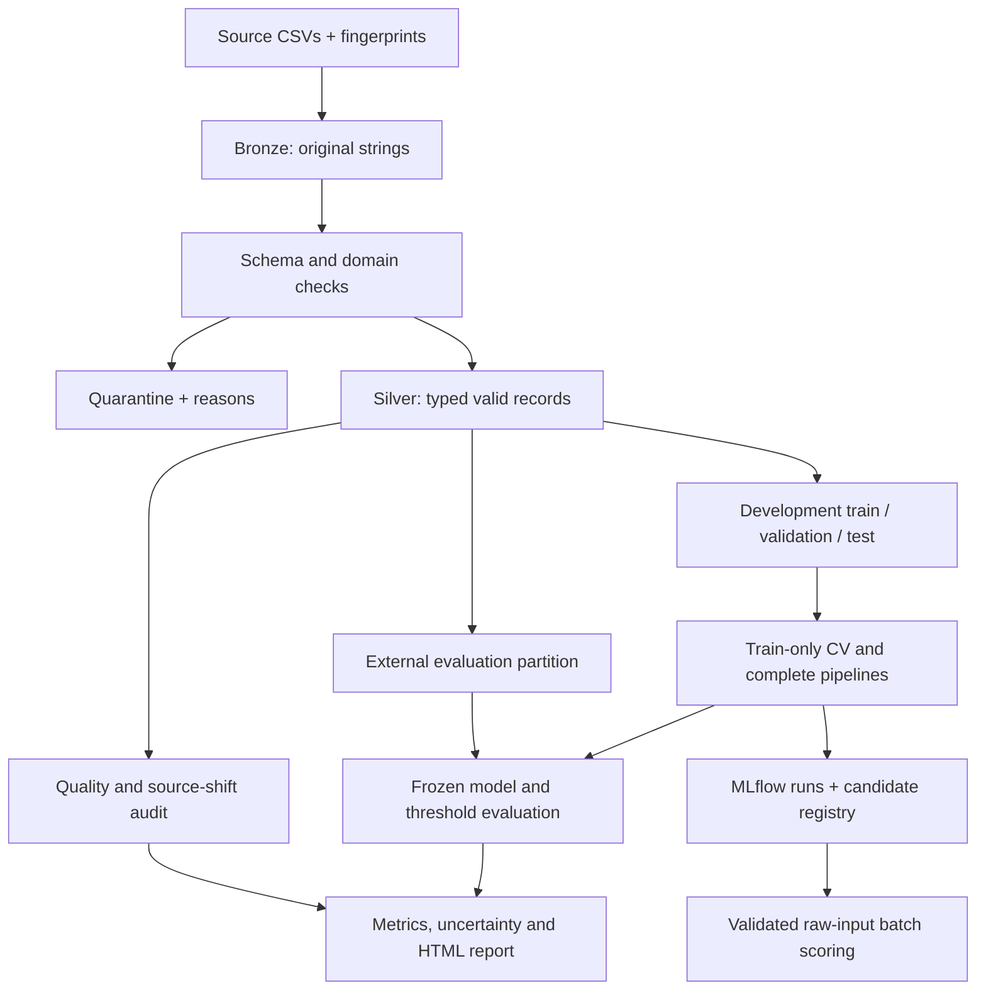
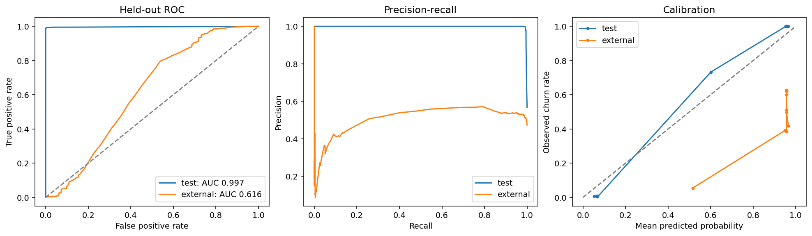

# Customer Churn · PySpark, Databricks & MLflow

[](https://github.com/Benvenuteo/customer-churn-databricks-mlflow/actions/workflows/ci.yml)


A PySpark/MLlib portfolio study of **generalization across two customer datasets**, with data quality, stratified cross-validation, complete model pipelines, MLflow lineage and held-out uncertainty estimates.

**[Executed notebook](notebooks/01_study_review.ipynb) · [Report download](https://github.com/Benvenuteo/customer-churn-databricks-mlflow/raw/refs/heads/main/reports/provided-v1/report/index.html) · [Run in Polish](docs/START_PL.md) · [Databricks setup](docs/DATABRICKS.md)**

> **Key finding:** internal churn ROC-AUC of **0.997** falls to **0.616** on the external file. The project explains this gap and preserves the external evaluation instead of selecting a new model against it.

## Start here

The executed notebook includes tables and embedded plots and can be reviewed on GitHub without installing Spark. For the full report, download the HTML file above and open it in a browser; its plots are embedded, so it works offline. GitHub displays HTML source rather than running the report.

| What to review | Evidence |
| --- | --- |
| Data engineering | Explicit schemas, bronze/silver/quarantine, reconciliation, duplicate and identity checks |
| Model validation | Train-only preprocessing, stratified CV, separate threshold selection, fixed external evaluation |
| ML engineering | Installable package, CLI, complete MLflow pipelines, registry aliases, model reload checks, raw-input batch scoring |
| Analytical interpretation | Source-shift audit, calibration, top-decile lift, baselines, bootstrap intervals and model card |
| Reproducibility | Input fingerprints, dependency locks, automated tests, container smoke run and measured result artifacts |

The starting university notebook demonstrated Ridge, Lasso, logistic regression, MLflow and Azure Databricks AutoML. This rewrite makes their information sets explicit and evaluates transfer to the supplied external file. The historical notebook ran on Azure Databricks; the rewritten implementation's measured results were produced **locally**. Databricks execution and AutoML are separate, explicitly unexecuted integration steps until a compatible authenticated workspace runs them.

## Pipeline architecture



Local storage uses Parquet; the Databricks notebooks use Delta under a configured Unity Catalog Volume. The two model tasks share the same frozen data partitions. The diagram summarizes the flow; the exact separation of fitting, threshold selection and held-out evaluation is specified below.

## Measured result and why it matters

| Measurement | Result |
| --- | ---: |
| Valid development records | 440,832 |
| Completely empty source records quarantined | 1 |
| External records | 64,374 |
| Training / validation / internal test | 308,582 / 66,125 / 66,125 |
| Training-only CV sample | 77,490 (requested 25%) |
| CV folds | 3 |
| Selected churn candidate | GBT, depth 5, 20 iterations |
| Internal test ROC-AUC | 0.9972 |
| External ROC-AUC | 0.6162 |
| External top-decile lift | 0.8909 |
| Selected spending candidate | GBT, depth 3, 20 iterations |
| External spending RMSE / R² | 265.8363 / −0.0384 |

The classifier's strong internal score does **not** transfer to the external file. Its selected top decile has a lower observed churn rate than the external population average. The report preserves this result rather than retuning against the external labels.

The data audit gives a concrete warning: with at least six support calls, churn is 100% in development and approximately 61% in the external file. ID/churn associations and feature distributions also differ. This is observed between-file distribution/conditional shift; timestamps and a causal generation process are not available, so temporal drift or target leakage is not asserted as proven.

See the [self-contained HTML report](reports/provided-v1/report/index.html), [measured artifacts](reports/provided-v1), and [executed review notebook](notebooks/01_study_review.ipynb). The HTML embeds all plots and can be downloaded as one file.



## Questions and success criteria

1. Can recorded customer attributes discriminate the supplied `Churn` label, and does performance transfer to the other file?
2. How do OLS, Ridge, Lasso, Elastic Net and a nonlinear candidate compare for estimating recorded `Total Spend`?
3. Can the complete preprocessing/model pipeline be saved, reloaded and used on raw input columns with matching predictions?

For classification we report ROC-AUC, average precision (AP), precision/recall/F1, accuracy, Brier score, log loss, confusion counts and top-decile ranking quality. AP is the precision-recall summary, not a mislabeled trapezoidal integral. For spending we report MAE, RMSE and R² in the dataset's spending units; no currency is assumed.

The files contain no verified observation timestamp or prediction horizon. This study does not estimate future 30-day churn, causal retention effects or customer lifetime value.

## Data and quality

Source: [Muhammad Shahid Azeem, Customer Churn Dataset](https://www.kaggle.com/datasets/muhammadshahidazeem/customer-churn-dataset), version 1. The data card lists GPL 2. Raw CSVs are excluded from Git and the project ZIP; the manifest records their exact sizes and SHA-256 hashes.

- `customer_churn_dataset-training-master.csv`: 440,833 rows, including one fully empty row.
- `customer_churn_dataset-testing-master.csv`: 64,374 rows.

Place both files in `data/raw/`. Alternatively run `python scripts/download_data.py --destination data/raw` to stream the public version-1 archive. If Kaggle requires authentication, download the two files manually; credentials do not belong in the repository.

Preparation validates the exact 12-column header, preserves raw strings in bronze, creates typed silver data and quarantines invalid targets/domains. Missing predictors remain available for train-only imputation. Legitimate extremes are not automatically trimmed. The contract requires unambiguous within-file customer IDs and checks exact feature duplicates before splitting. Shared ID values across files are audited and never automatically treated as the same person.

## Validation protocol

Development data is deterministically stratified 70/15/15 by churn. Only development training rows enter the CV sample. Three approximately stratified folds select candidates using mean ROC-AUC or RMSE; fold SD is descriptive, not a confidence interval.

Each fold learns its own imputations and category encodings. The selected candidate is refitted on **all 308,582 training rows**. Validation chooses the classification threshold by F1. The frozen model and threshold are then evaluated on the internal test and external file. The report's ROC curves and legends use the same held-out population.

The default 25% fraction applies only to the training CV search, not data preparation, final fitting or held-out evaluation. Set `--cv-fraction 1` for a more expensive full-training CV search; those results must be recorded as a separate experiment.

Classifier candidates are L2 logistic regression and two GBT depths. Regression candidates are OLS, three Ridge penalties, three Lasso penalties, Elastic Net and GBT. The prior/mean baselines are estimated on training labels only. The winning model is not selected again after external evaluation. Bootstrap intervals condition on the fixed fitted model and exclude training/split uncertainty.

## Run locally

Use Python 3.11 and Java 17. Windows users can use Docker Desktop/WSL2; see [the Polish quick start](docs/START_PL.md).

```bash
python -m venv .venv
source .venv/bin/activate
python -m pip install -r requirements-dev.txt
python -m pip install --no-deps -e .

churn run --training data/raw/customer_churn_dataset-training-master.csv \
  --external data/raw/customer_churn_dataset-testing-master.csv \
  --output outputs/provided-v1 --run-id provided-v1
```

Open `outputs/provided-v1/report/index.html`. Output directories must be new/empty. To run stages separately, replace `run` with `prepare`, then execute `churn train --output outputs/provided-v1`. A completed task is protected from replacement; `churn report --output outputs/provided-v1` only redraws artifacts.

```bash
churn demo --rows 600
churn run --training data/demo/development.csv --external data/demo/external.csv \
  --output outputs/smoke --run-id smoke --data-kind synthetic --profile smoke
```

The smoke profile is synthetic, with a smaller grid and bootstrap budget. Its metrics must never be substituted for the supplied-data results.

## Docker and MLflow UI

```bash
docker compose build study
docker compose run --rm study churn run \
  --training data/raw/customer_churn_dataset-training-master.csv \
  --external data/raw/customer_churn_dataset-testing-master.csv \
  --output outputs/provided-v1 --run-id provided-v1
docker compose --profile ui up tracking
```

After a Docker run, open `http://localhost:5000`. For a native local run, use `mlflow ui --backend-store-uri sqlite:///outputs/provided-v1/mlflow.db`. MLflow uses an isolated SQLite store per local run; on Databricks it uses the configured shared tracking service. Artifact locations belong to the environment in which they were created; native Spark model exports are the portable handoff.

Allow several GB of free disk space and at least 4 GB available RAM for the local process; more headroom helps. `SPARK_DRIVER_MEMORY` controls the Docker driver heap (default 2 GB). Training uses local Spark, not a claimed distributed production benchmark. The full-data study used native Python/Java execution; GitHub Actions additionally built the Docker image and completed both model tasks and batch scoring on synthetic data inside the container.

## Score raw records

```bash
churn score --input data/raw/customer_churn_dataset-testing-master.csv \
  --model outputs/provided-v1/models/classification --task classification \
  --output outputs/new-scores
```

Input may use original or normalized headers and may omit target columns. Required feature columns must be present. Missing predictors are imputed using saved training values; new categories are supported. Invalid supplied numeric values fail explicitly. Classification uses the saved validation threshold, or an explicit `--threshold` for a separately copied model.

The handoff ZIP includes `examples/provided-v1/models` and matching threshold metadata. These native Spark pipelines can be scored without repeating model selection. They are illustrative candidate models with the measured transfer limitations above.

## Databricks integration

See [workspace setup and job instructions](docs/DATABRICKS.md). The notebooks use the managed Spark session, Delta tables under an authorized Volume and MLflow's Databricks backend. The bundle defines sequential prepare, classification, regression and report tasks; serialization avoids conflicting writes to the shared run manifest.

AutoML is an optional fifth notebook, outside the default job. It whitelists the same features, supplies the frozen `split` column and evaluates the winner on the same holdouts. It records actual metric keys instead of assuming keys such as `rmse` exist. Its time budget and manual CV's sample budget differ and are reported explicitly. No AutoML result is fabricated when a compatible workspace is unavailable.

## Checks and project layout

```bash
ruff check .
ruff format --check .
pytest -q
python -m build --wheel
```

Tests cover adverse records, missing predictors, schema order, stable stratification, ID exclusion, matched AutoML inputs, metric definitions, unknown categories and whole-pipeline serialization. Local smoke/full runs additionally exercise MLflow model logging, native load-back equality, registry aliases, reports and batch scoring. The GitHub Actions workflow runs tests, a native synthetic MLflow smoke run, wheel packaging and a separate Docker build/smoke run on each push and pull request. Synthetic CI results validate the execution path; the committed full-data study remains the source of analytical results.

**Verified on GitHub Actions:** [24 tests passed; native and Docker pipeline checks succeeded](https://github.com/Benvenuteo/customer-churn-databricks-mlflow/actions/runs/40354789841). The tested code commit and verification scope are recorded in [verification.json](reports/verification.json).

| Location | Purpose |
| --- | --- |
| `src/churn_study` | Data preparation, CV, metrics, MLflow, scoring and reports |
| `databricks` and `databricks.yml` | Platform notebooks and parameterized job bundle |
| `notebooks` | Executed presentation of measured results |
| `reports/provided-v1` | Small measured artifacts and self-contained report |
| `tests` | Data, validation, metrics and serialization checks |
| `docs` | Protocol, original-notebook audit, model card and run instructions |

Main Python dependencies and transitive local requirements are pinned. Spark comes from the ML runtime on Databricks; do not install the `local` extra there. The package keeps cloud runtime dependencies compatible without replacing the platform Spark installation.

To rerun the presentation notebook locally, install `requirements-notebooks.txt` and start `jupyter lab`. That lock is constrained to the development lock so shared notebook dependencies stay compatible. Local SQLAlchemy is pinned below 2.1 for the tested MLflow 3.5 tracking store.

For a Polish project description and a short interview walkthrough, see [the portfolio notes](docs/PORTFOLIO_PL.md).
